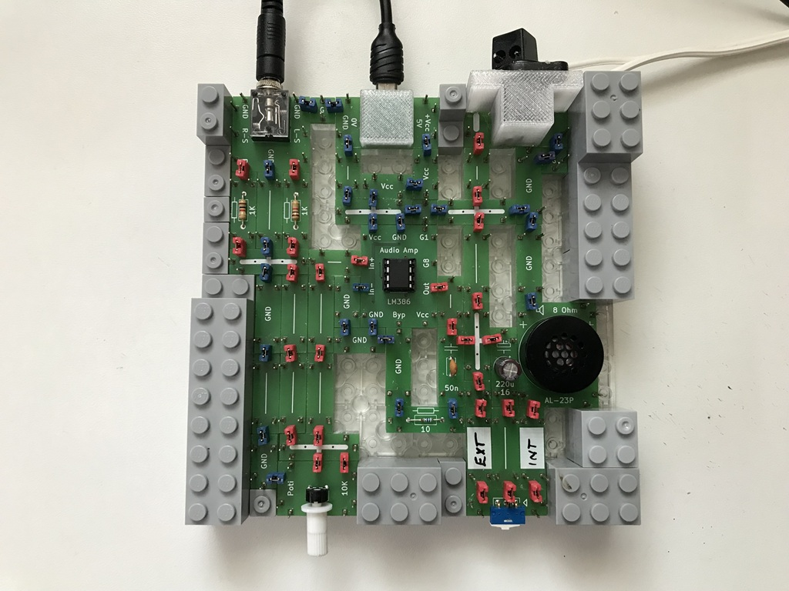
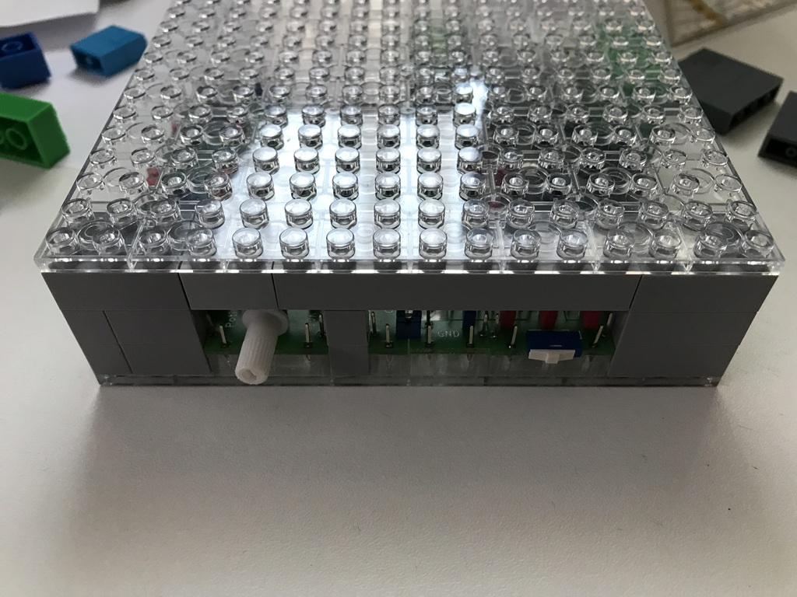
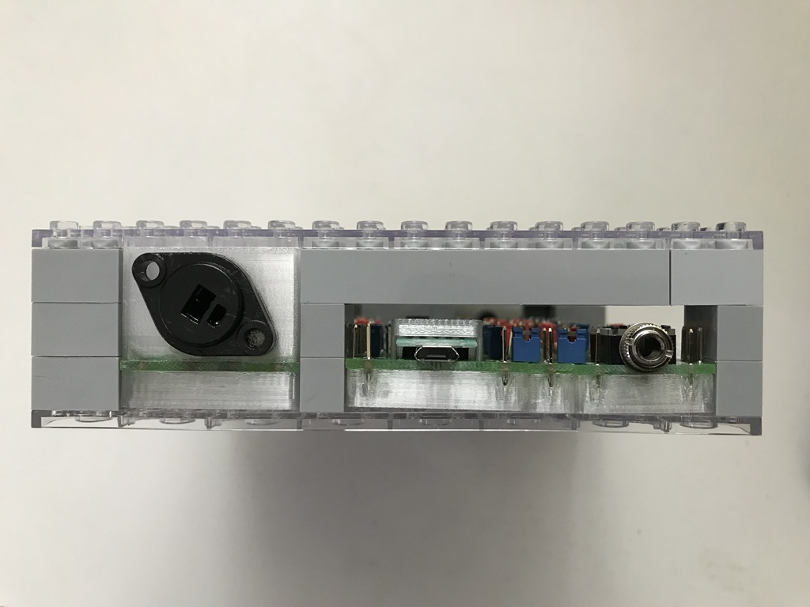

# Electronics With Bricks

## Amplifier LM386

The LM386 is an integrated audio power amplifier designed for low-power-consumption devices. This application was developed to explore the capabilities of this interesting microchip.

In terms of the circuit layout, special attention was paid to achieving a form factor that—much like a printed circuit board—can be fitted directly into a device enclosure. The connections are positioned at the rear, while the control element is located at the front. In this way, the application also effectively demonstrates the potential of the modular construction system.

As a further distinctive feature, the signal paths in this setup are connected using red jumpers, which allows the signal path to stand out visually from the rest of the circuit.

The circuit is taken from the official product datasheet for the LM386 and can be found here:

https://cdn-reichelt.de/documents/datenblatt/A200/LM386.pdf

---

*In Operation:*

---

An add-on allows for switching to an external speaker. This enables good sound quality, whereas the internal small speaker does not meet high standards.

*External Speaker Support:*

---

*Building an enclosure made of standard bricks:*

| | |
| :--- | :--- |
|||

---

Copyright (c) 2024-2026 sun9qd

