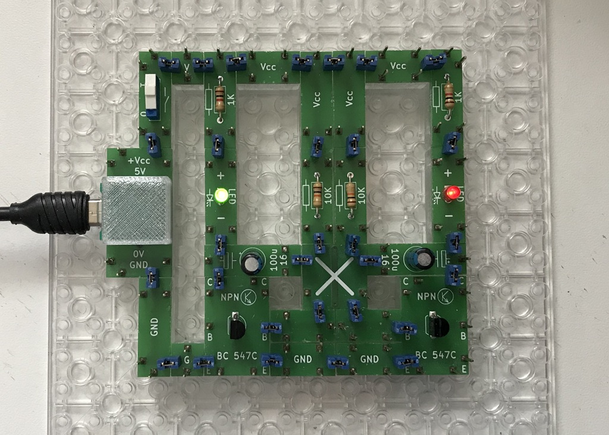
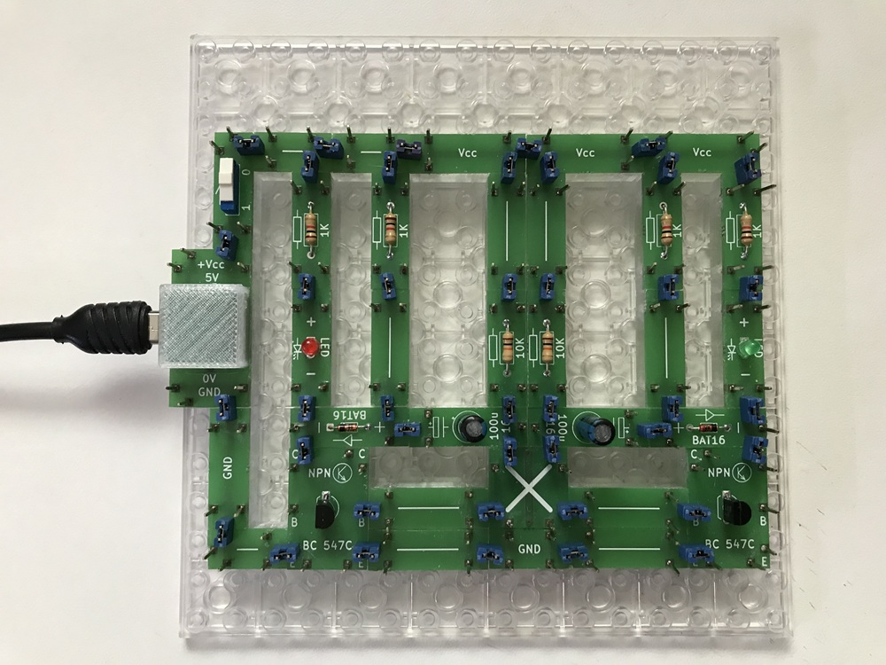
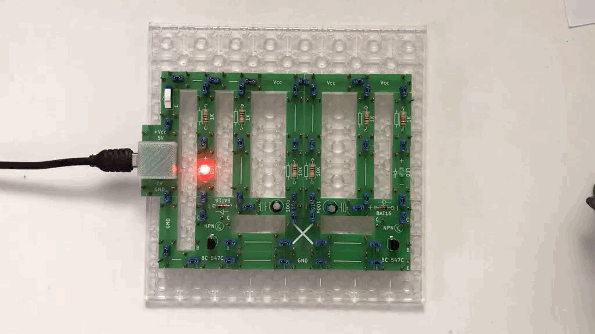

# Electronics With Bricks

## Flip-Flop

The flip-flop circuit provides two alternately flashing LEDs that are controlled by two coupled timers. The timing components are a resistor and a capacitor, and there are two transistors as switches and to drive the LEDs.

*The circuit:*

---

## Improved Flip-Flop

An improved version with sharper edge control for the generated square-wave signal. This ensures that the LEDs are either on or off, and never in an intermediate state.

I found the circuit here: [electronics.stackexchange.com/questions/157446/how-does-the-improved-transistor-astable-multivibrator-work](electronics.stackexchange.com/questions/157446/how-does-the-improved-transistor-astable-multivibrator-work)

*Improved Circuit:*

---

*Improved Circuit Running:*

---

Copyright (c) 2024-2026 sun9qd

