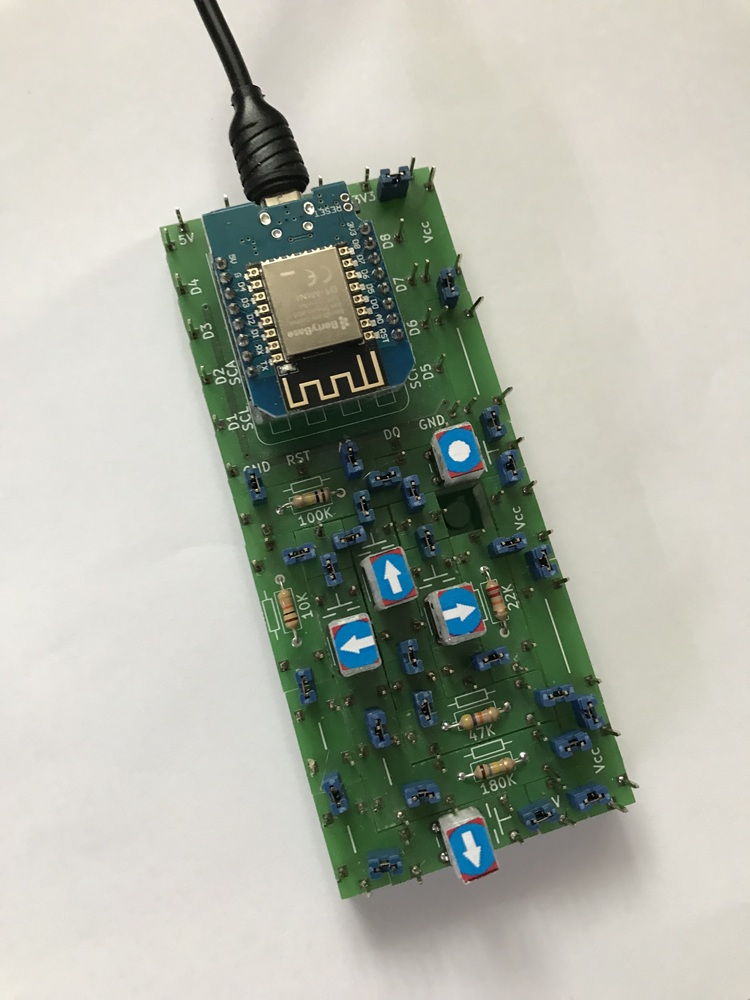
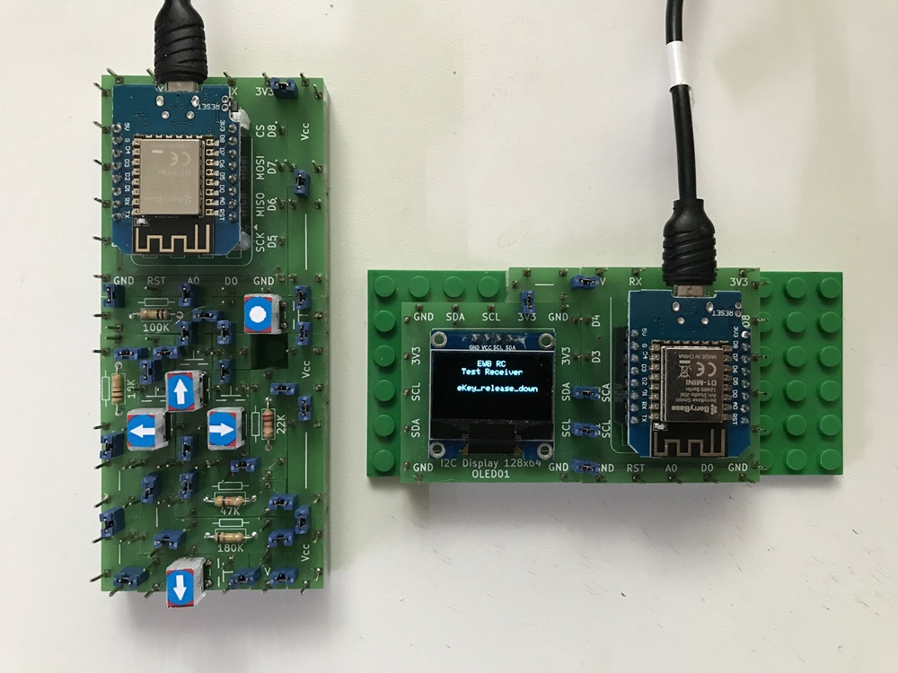
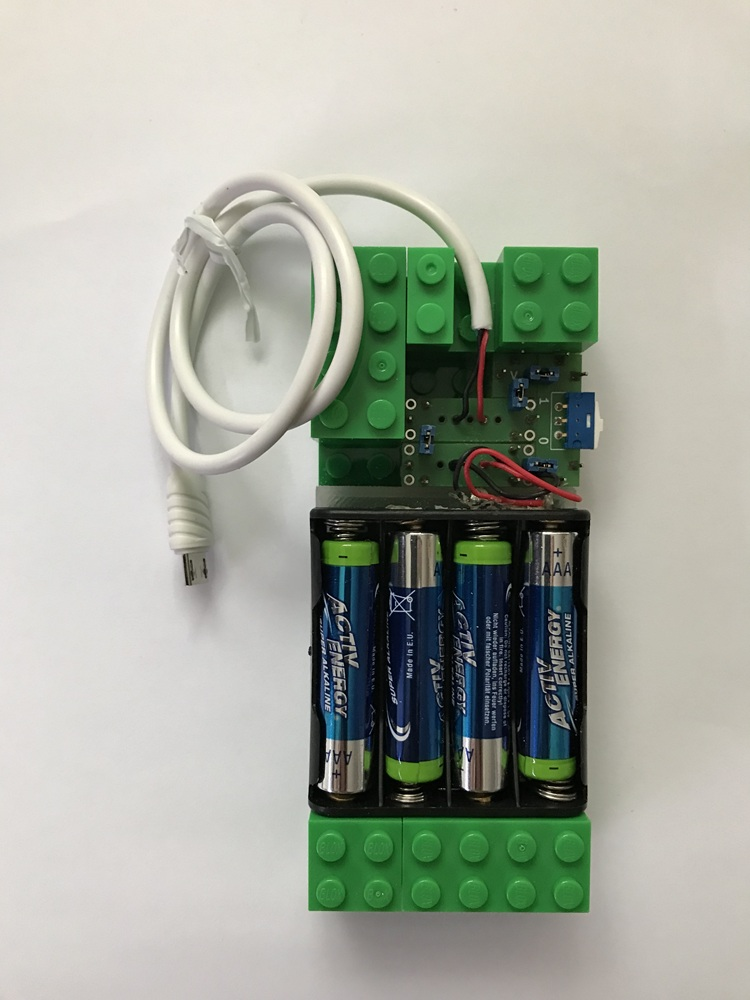

# Electronics With Bricks

## Remote Control Handset

This experiment features a handheld remote control unit. It has 5 buttons, each of which can be pressed individually. The device was built in a very compact manner on a 14x6 stud plate, in order to get as close as possible to the look and feel of a standard remote control.

*The handset unit:*

---
The remote control sends an HTTP message to an associated web server — integrated into the device being controlled — both when a button is pressed and when it is released. The possible messages are:

- Power / PowerRelease
- Left / LeftRelease
- Right / RightRelease
- Up / UpRelease
- Down / DownRelease

The handset transmits these messages without regard for their meaning. The significance and impact of the button presses — and the resulting actions — are determined solely by the remote device.

The states of the buttons are detected by a D1 Mini microprocessor board via its built-in ADC (analog-to-digital converter), accessible at pin A0. By engaging resistors of varying ohmic values, the buttons generate different voltage levels at this pin, which are then captured and processed by the microprocessor’s software.

The D1 Mini microprocessor in the handset uses a Wi-Fi connection to communicate with a corresponding processor within the device being controlled. This device—typically also constructed using the "Electronics-With-Bricks" kit—establishes a Wi-Fi access point upon startup, with both the network name and password known to both units. Consequently, connecting to a home Wi-Fi network is not required.

The programm for the D1mini is available at [Resources/Software/ewb_rc_handset/ewb_rc_handset.ino](../../Resources/Software/ewb_rc_handset/ewb_rc_handset.ino).

---

## Test Receiver

To test the remote control, a small test circuit was set up. It consists of a D1 Mini running the appropriate server software to receive remote control commands, along with a small I2C display to show the received data. 

*Handset with Test Receiver:*

The programm of the test receiver D1mini is available at [Resources/Software/ewb_rc_testreceiver/ewb_rc_testreceiver.ino](../../Resources/Software/ewb_rc_testreceiver/ewb_rc_testreceiver.ino).

---

## Battery Pack

An optional battery pack is available for the remote control handset; it can be attached from underneath, making the device portable.

*Battery pack:*

---

Copyright (c) 2024-2026 sun9qd

