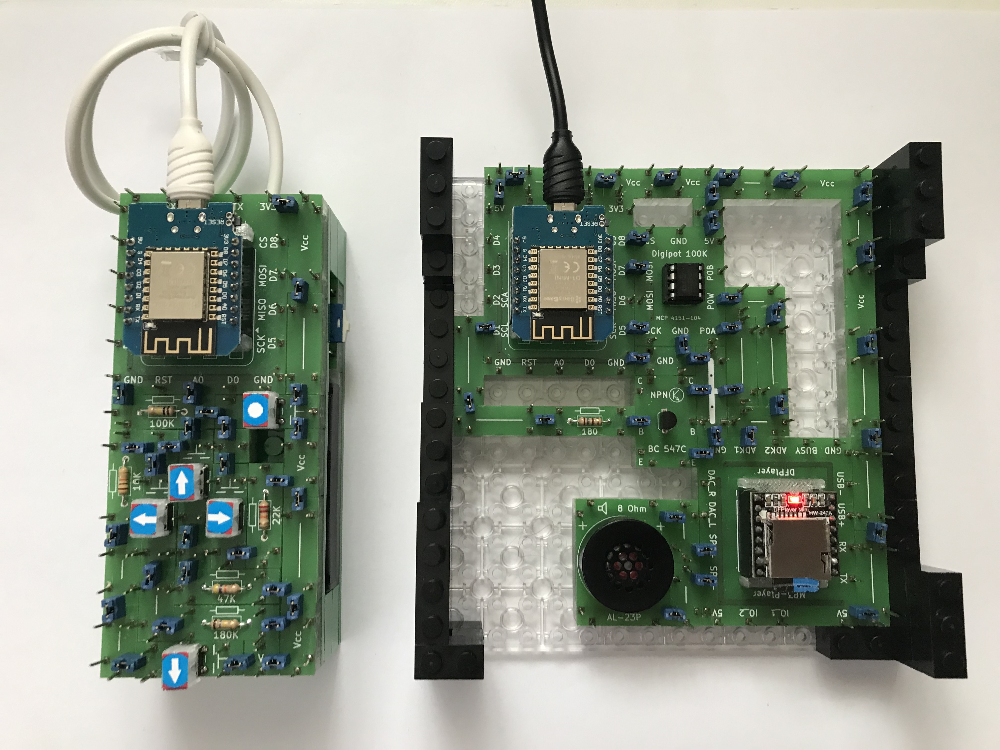
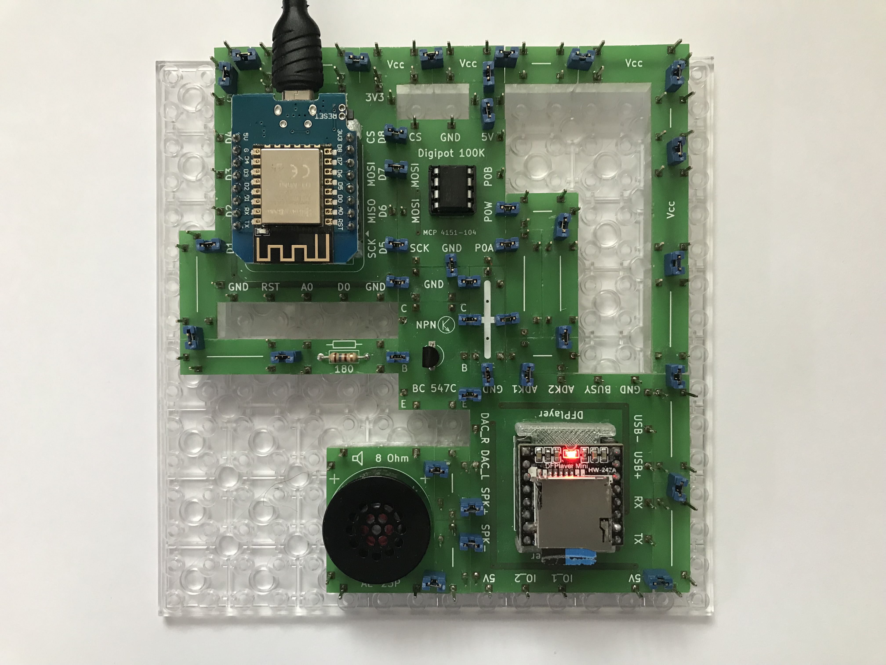

# Electronics With Bricks

## Remote Controlled MP3 Player

In this project, the previously introduced MP3 player has been modified to allow for remote control using the already familiar handheld remote unit. The brick walls on the sides of the player are used to allow a second baseplate to be attached on top as a dust cover.

The functions assigned to the buttons on the remote control are as follows:

- Power: Play and Pause
- Up: Increase volume
- Down: Decrease volume
- Left: Previous song
- Right: Next song

The "DFPlayer" module used in the circuit is controlled in the same way as in the version that uses physical push-buttons. In this setup, the resistor array has been replaced by a 100 kΩ digital potentiometer (digipot). The push-buttons from the original version are replaced by a transistor in this remote-controlled version.

The digital potentiometer is controlled by the D1 Mini microprocessor via the SPI interface. The transistor functions as a switch, with its base driven directly by the D1 port of the D1 Mini.

The software for the D1mini is available at [Resources/Software/ewb_rc_mp3player/ewb_rc_mp3player.ino](../../Resources/Software/ewb_rc_mp3player/ewb_rc_mp3player.ino).

Copyright (c) 2024-2026 sun9qd

