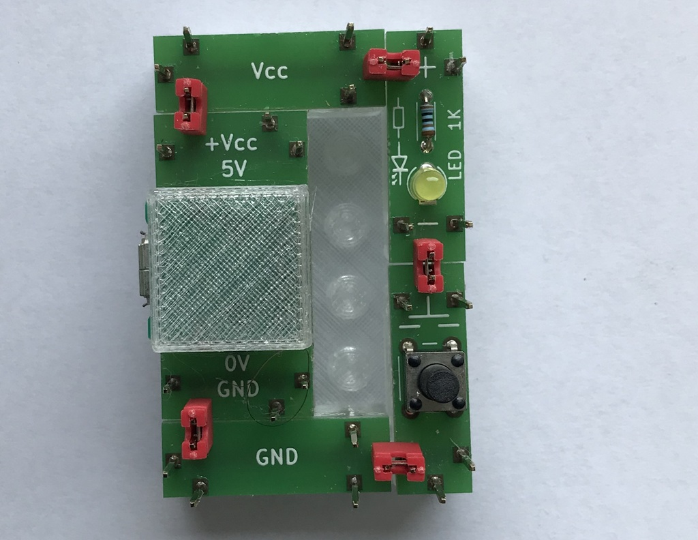
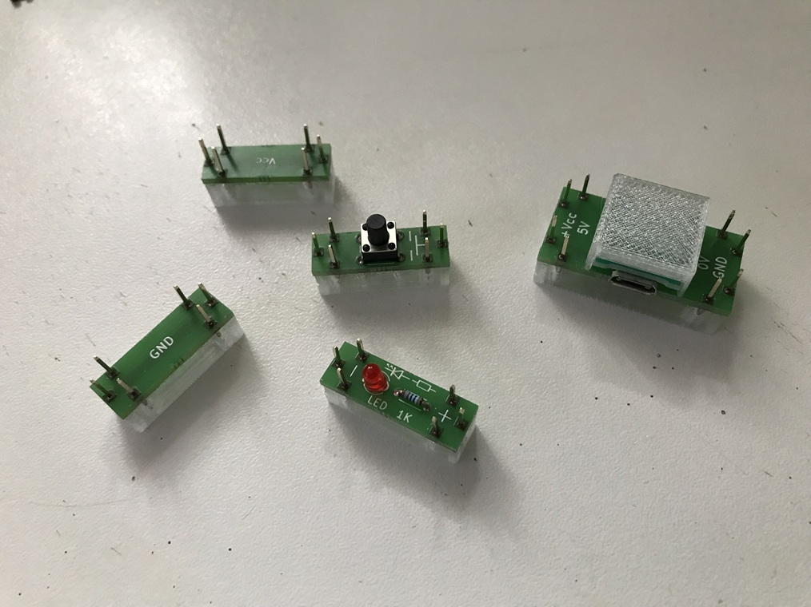
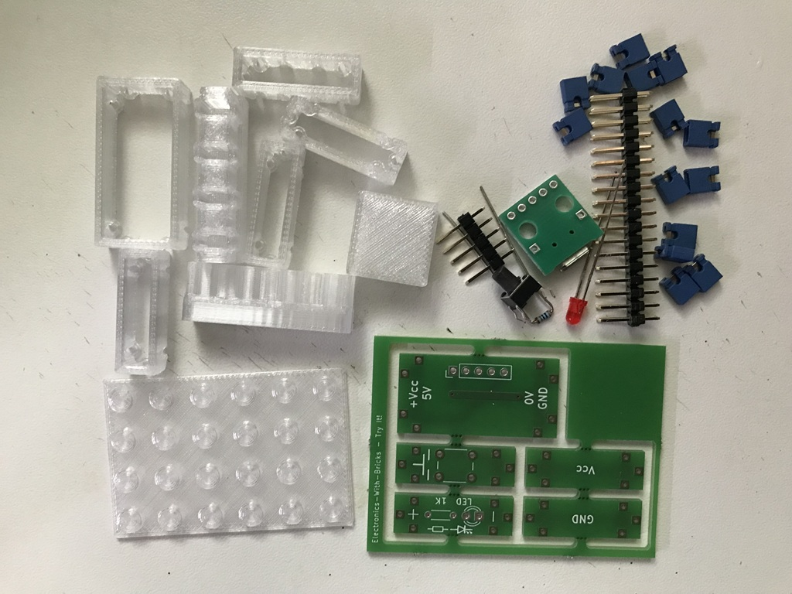

# Electronics With Bricks: Kits

The electronics construction kit is available in several expansion stages, which are presented here.

## Try It!

The TryIt! Kit is a very simple starter construction set comprising just five components, designed to introduce the modular building concept. It also serves as a simple, affordable option for trying out the assembly process before tackling larger projects.

The "Try It!" application (with special colors of jumpers and LED):

The bricks available in the kit:

The parts from which the bricks can be built:

The DIY-downloads for reproduction can be found at
| | |
|:---------|:------------------------------------|
|PCB:      |Resources/gbr/board_Kit_TryIt.gbr.zip|
|3D-Parts: |Resources/stl/Kit_TryIt.stl|

The 3D-Parts were printed with transparent PETG.

Copyright (c) 2024-2026 sun9qd

