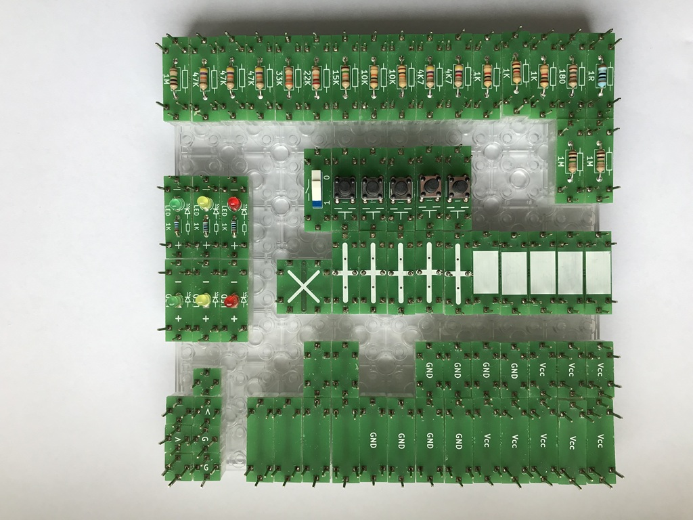
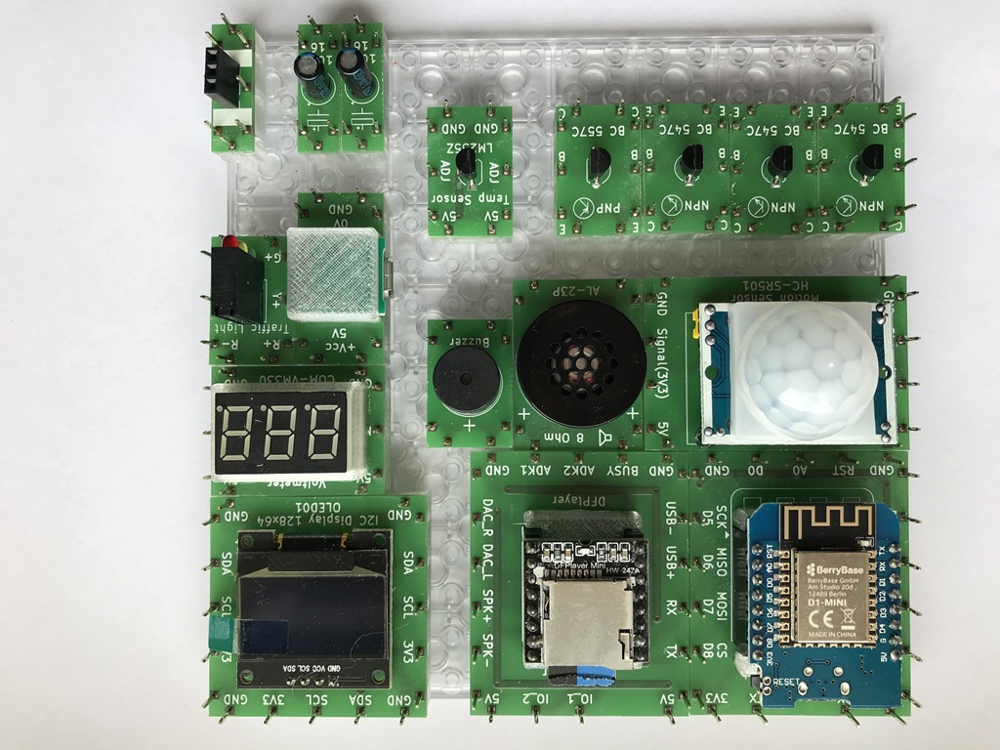
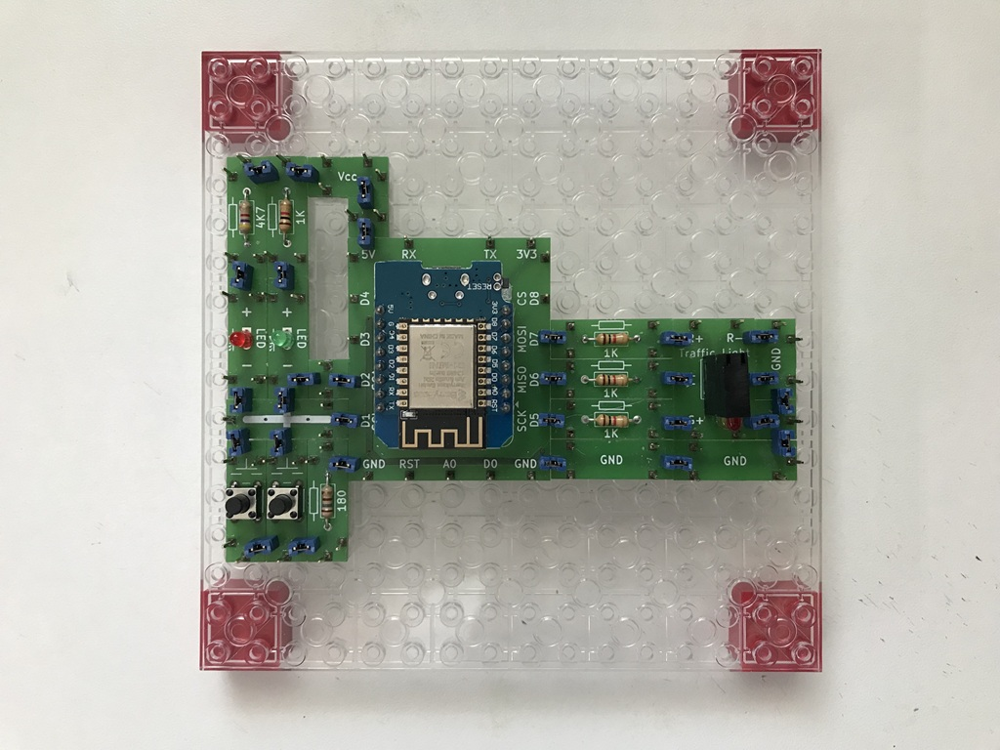

# Electronics With Bricks: Kits

The electronics construction kit is available in several sets. For a more detailed description of the kits please go to the appropriate subdirectories.

|  |  |
|:---------|:-----------------------------------------------|
||**TryIt!**  is a very simple starter construction set comprising just five components, designed to introduce the modular building concept. It also serves as a simple, affordable option for trying out the assembly process before tackling larger projects.|
||**Basic**  is a perfect starter kit for building a lot of amazing machines. It comprises around 90 bricks and you can reproduce many of the projects on this web page. The kit is also ideal for realizing your own analog and digital construction ideas.|
||**TrafficLight**  is a themed construction set for building a traffic light with a simple control panel.|

Please note: The illustrations are similar to the described construction sets which may be updated from time to time and may also show components (e.g., base plates) that are not included in the sets.

Copyright (c) 2024-2026 sun9qd

