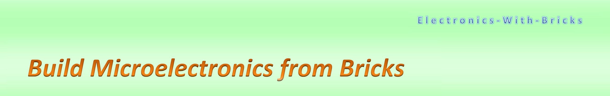
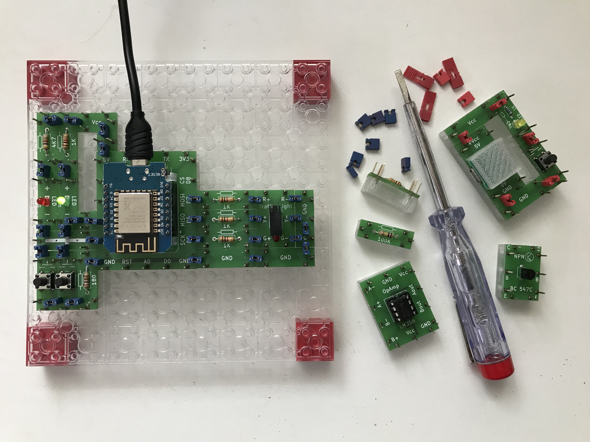
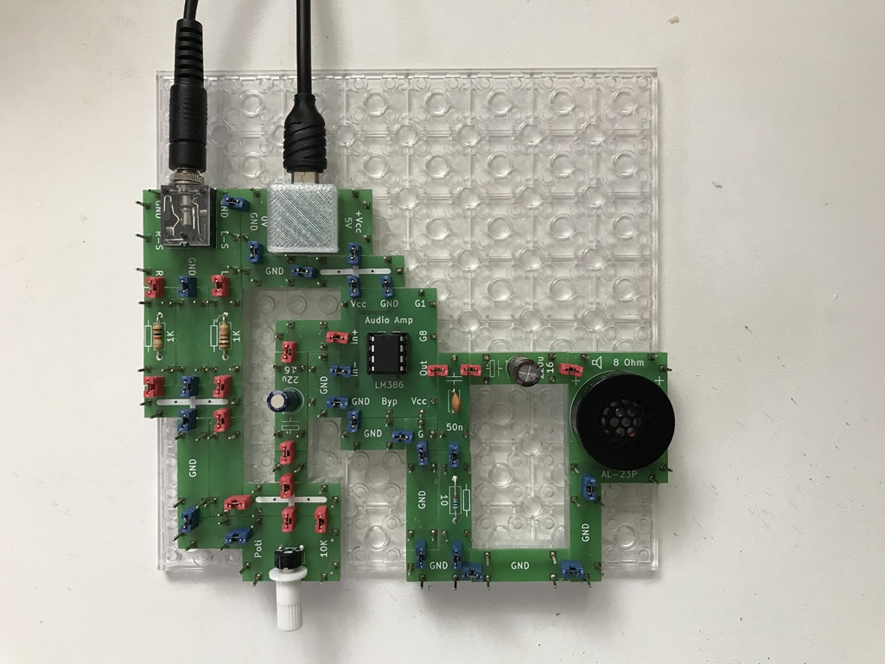

---

This project presents an electronic construction kit on 8 mm studded base panel, compatible with standard systems, supporting numerous analog and digital components. From this various analog and digital circuits can be built.

---

*The latest project built with the construction kit:*

A miniature audio amplifier circuit using the LM386 integrated power amplifier, in accordance with the recommendations in the product datasheet.

---

The kit is intended for:

1. Learning and training
2. Evaluation of electronic components
3. Development of electronic circuits
4. Presentation of technical systems

Compared to using a breadboard, there are some advantages.

1. *Circuit layout  like a photograph of the circuit diagram.*
The wires can be freely routed in two dimensions, whereas on a breadboard, one direction is restricted by the fixed internal wiring. Components and connections are labeled. The tangle of wires is replaced by clearly identifiable jumper connectors.

2. *Robust construction—almost like a manufactured circuit board.*
The components hold firmly to the baseplate, and the jumper connections establish reliable electrical contact. No exposed wires posing a short-circuit risk. 

3. *It’s really fun working with it.*
Finding the best way to lay out the circuit on the base plate. It feels like an amazing, addictive game of skill.

---

The repository is structured as follows:

- **Applications/** contains a number of experiments built with the kit
- **Bricks/** contains an overview of the available bricks
- **Kits/** presents several construction kits with varying assortments of building blocks
- **Resources/** contains the resources for reproducing the bricks (BOM, STL and Gerber files, software) and a description how to do that (coming soon)

---

## ⚖️ License & Community Guidelines

This project uses a dual-licensing model to balance open-source collaboration with commercial sustainability:
* 💻 **Software / Firmware:** Licensed under the highly permissive **MIT License** (feel free to use, modify, and integrate the code anywhere).
* 🛠️ **Hardware (STL, Gerber, CAD):** Licensed under **CC BY-NC-SA 4.0** (Attribution-NonCommercial-ShareAlike).

---

### 💚 Maker & Community Fair-Use Policy
We love the Maker community and want you to build, share, and improve this project! To clear up the legal gray areas of the "Non-Commercial" (NC) clause, **we explicitly permit and encourage** the following activities:

* 🎥 **Content Creation:** You are fully allowed to feature this project in monetized YouTube videos, Twitch streams, TikToks, or personal blogs. 
* 🏫 **Education & Labs:** Schools, universities, Hackerspaces, and FabLabs are explicitly allowed to print the parts and produce the PCBs for educational purposes, workshops, or members (even if a small fee is charged to cover pure material/machine costs).
* 🔧 **Personal Modifications:** You can remix and modify the hardware for your personal use. If you publish your remix, just remember it must also be shared under CC BY-NC-SA.

---

### 🚫 What is NOT Allowed?
* **Selling Kits or Assembled Units:** You may not manufacture, package, and sell physical DIY kits or fully pre-assembled units of this project on platforms like Etsy, eBay, Tindie, or your own webshop.
* **Commercial Derivatives:** You may not modify the hardware designs and sell the resulting product commercially.

*Note: As the original author, I retain the exclusive rights to offer official DIY kits and pre-assembled products in the future. If you plan a commercial project based on this work, please reach out for commercial licensing options.*

---

## 🤝 Contributing

We welcome contributions from the community! Before submitting a Pull Request, please read our [Contribution Guidelines](CONTRIBUTING.md) to understand our development workflow and licensing agreements regarding community code and hardware modifications.

---

Note:

LEGO® is a trademark of the LEGO Group. This project is not sponsored, approved or supported by the LEGO Group.

**Warning: The construction kit presented works with electricity. Incorrect use, but also faulty components or circuits, can cause fires and even people and animals can suffer injuries from electric shocks. For this reason, it may only be used by qualified persons. To avoid hearing damage, headphones or in-ear monitors should not be used with this kit. Operation is at your own risk. No liability is assumed for damage resulting from improper assembly or operation.**

The 3D printing templates were created with OpenScad: https://openscad.org/

The board layouts were created with KiCad: https://www.kicad.org/

Some of the description text has been translated with the help of google translator: https://translate.google.com/

Copyright (c) 2024-2026 sun9qd

