# Electronics With Bricks: DIY Guide

## How To Build The TryIt! Kit

| | |
| :--- | :--- |
| 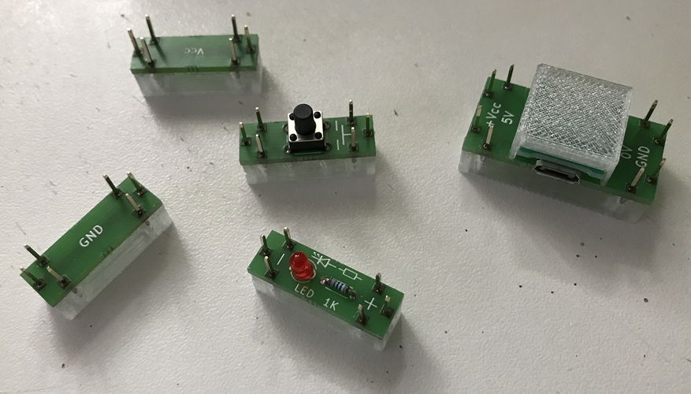 | For to learn how you can construct a brick by yourself please watch the following steps of the construction of the TryIt! kit: |
|For the small demo kit, you will need a printed circuit board (PCB) with breakout boards, a set of plastic parts, and various electronic components to populate the boards. You can download the Gerber files for the PCB layout here, as well as the STL files for 3D-printing the plastic parts. You can order the PCB from a manufacturer of your choice, and the plastic parts can either be 3D-printed yourself or ordered from a 3D-printing service. The electronic components can be purchased from an electronics retailer; example links to suitable items and links to the PCB/3D downloads can be found at [Resources/bom/bom_Kit_TryIt/README](../../Resources/bom/bom_Kit_TryIt/README.md). | 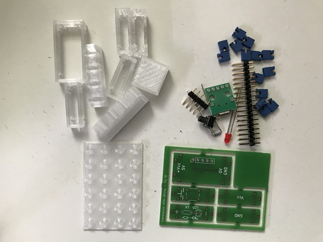 |
| 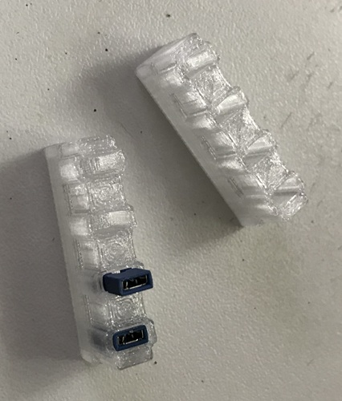|First, assemble the two SolderSupport bricks. To do this, insert a jumper into each of the four recesses, positioning them upside down (with the small handles facing downward). For a more secure fit, you can apply a little glue to the jumpers beforehand.|
|Place the SolderSupport bricks onto the base plate—included with the 3D-printed plastic parts—spacing them appropriately. Then, using needle-nose pliers, remove the required connectors from the dual-row pin header and insert them into the corresponding positions within the SolderSupport bricks' jumpers. Note: A dual-row pin header is used because it offers the lowest cost per connector. |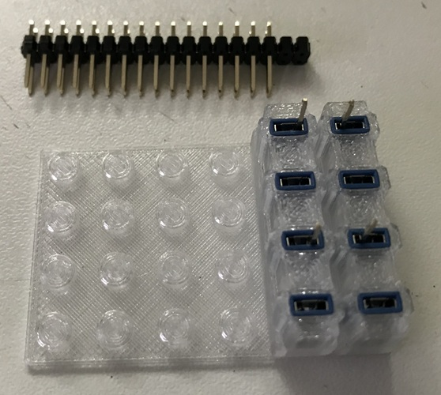|
|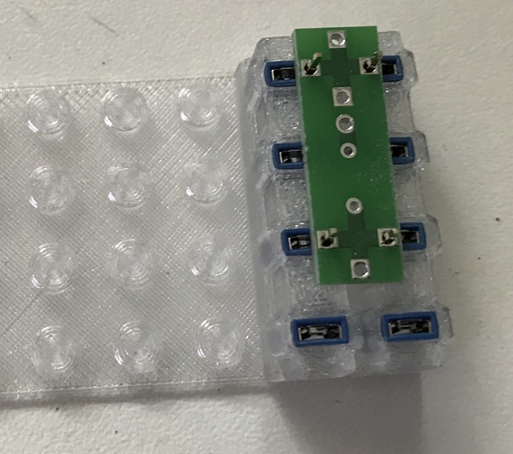|In the next step, one of the Brick Breakout boards is attached upside down (with the labeling facing downward) onto the SolderSupport Bricks, so that the connectors protrude from the underside of the board. They can then be soldered in place, resulting in a board with connectors on two opposite sides.  Please note: After being snapped out, the breakout boards must be filed smooth at the break-off points to ensure there are no protruding edges that could interfere when assembling the components later. |
| The process must be repeated for the other two sides. To do this, it may be necessary to adjust the spacing between the SolderSupport bricks. It is also possible to solder multiple boards simultaneously.|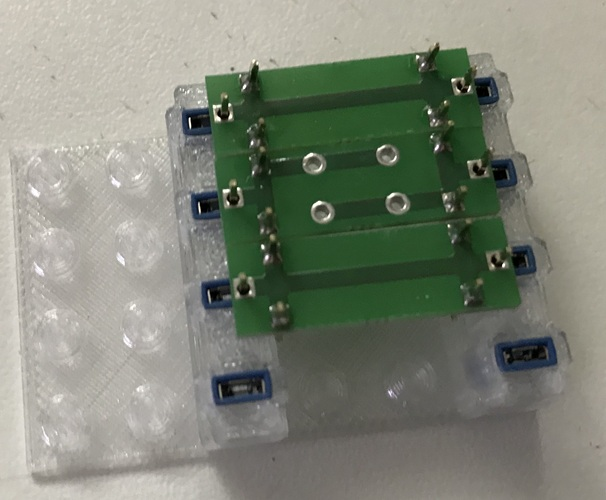 |
|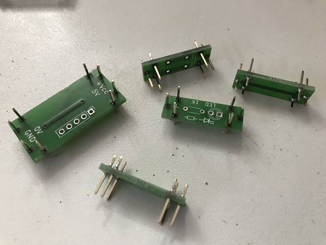 | The boards now have their connectors, which can be used to link them together with jumper plugs during later operation.|
| Work continues on populating the boards.|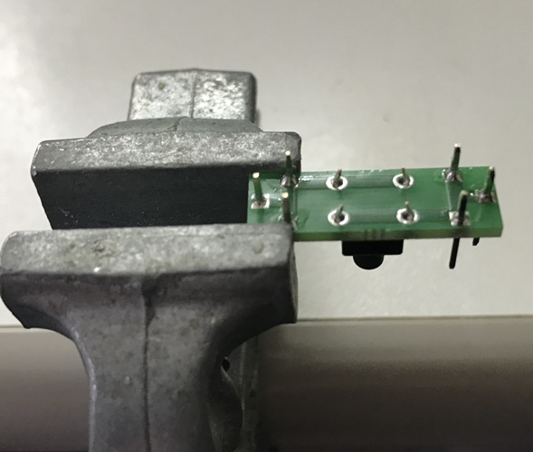 |
|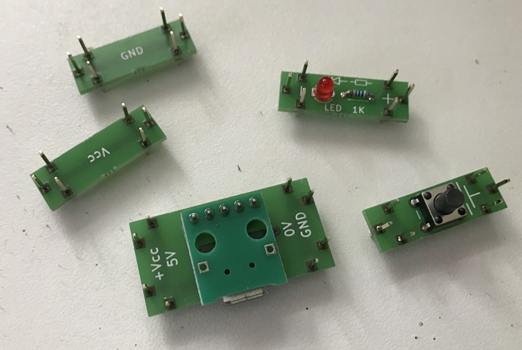|The circuit boards are now complete. For the power supply brick, a plastic cap still needs to be glued on, and there is an optional snap-on cover for the push-button that can be used to add a label. |
| Each circuit board is paired with its corresponding plastic housing. Please take care, as not all plastic housings are interchangeable—even if they have the same stud dimensions. The push-button, in particular, requires a specific plastic housing; otherwise, it cannot be attached. Once paired, the circuit boards are glued onto their respective plastic housings using model-making adhesive.|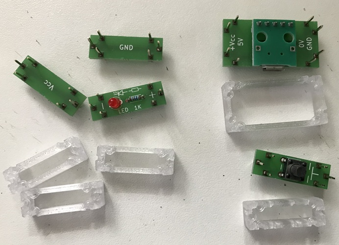|
|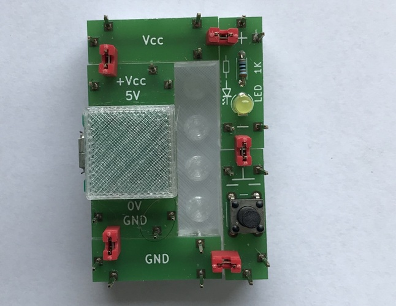|The components are now ready, and the circuit can be assembled.   Incidentally, there is also a second way to mount and connect the circuit compactly on the base plate. Can you figure out how?|

---

Thats it!

I hope you like your new bricks and produce quite many of them for inspiring projects with your new Construction Kit!

---

Copyright (c) 2024-2026 sun9qd

